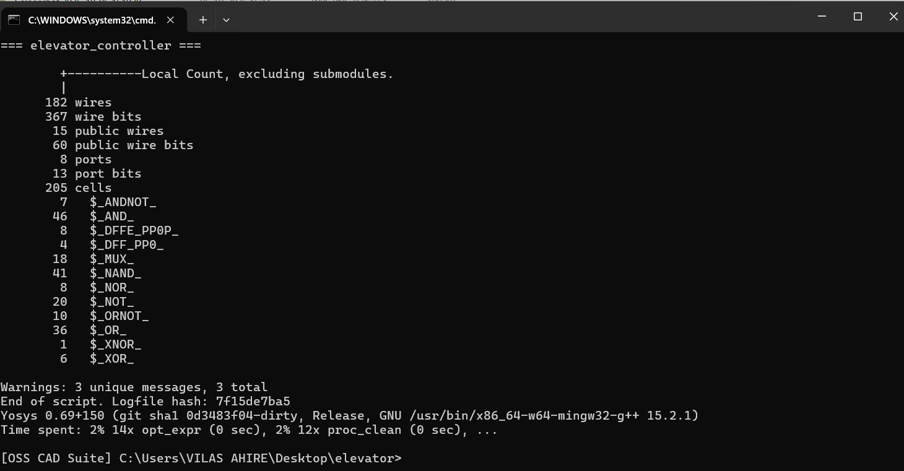
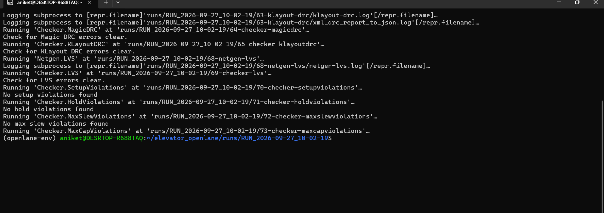
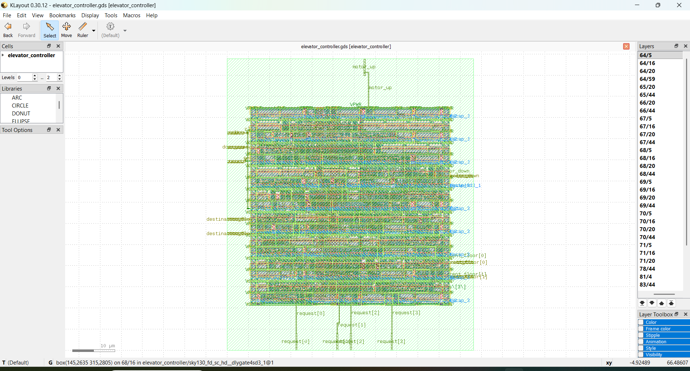

# Elevator Controller – RTL to Physical Design

## Project Overview

A multi-floor elevator controller designed using Verilog HDL and implemented through an RTL-to-physical-design workflow.

The design uses a Finite State Machine (FSM) to control elevator movement, floor requests, motor signals and door operations.

## Tools & Technologies

| Stage | Tools |
|---|---|
| RTL Design | Verilog HDL |
| Simulation | EDA Playground, Icarus Verilog |
| Waveform Analysis | GTKWave |
| Synthesis | Yosys |
| Physical Design | OpenLane |
| Layout Inspection | KLayout |

## Repository Structure

```text
VLSI-Design/
├── RTL/
│   └── elevator_controller.sv
├── Testbench/
│   └── elevator_controller_tb.sv
├── Netlist/
│   └── elevator_netlist.v
├── Simulation/
│   └── waveform_simulation.png
├── Physical_Design/
│   ├── openlane_screenshot.png
│   ├── yosys_synthesis_output.png
│   └── klayout_output.png
└── README.md
```

## Design Features

- Parameterized floor configuration
- FSM-based elevator control
- Floor request handling
- Upward and downward motor control
- Door operation control
- Configurable door timing

## 1. RTL Design

The elevator controller was implemented using Verilog HDL with a finite state machine to manage elevator operations.

## 2. Functional Simulation

The design was simulated using Icarus Verilog on EDA Playground. GTKWave was used to inspect signal transitions and verify the controller's behaviour.


## 3. Logic Synthesis

Yosys was used to synthesize the RTL design and generate a gate-level netlist.



## 4. Physical Design

OpenLane was used for the ASIC physical-design workflow. KLayout was used to inspect the generated layout.

**OpenLane Output**



**KLayout Output**



## Author

**Aniket Aher**

B.Tech – Electronics and Telecommunication Engineering
